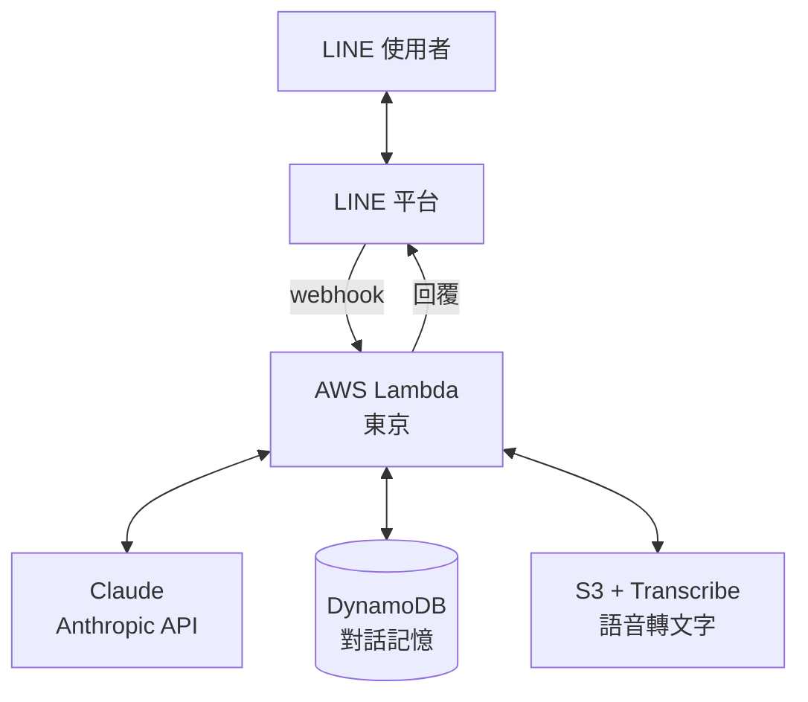

# 無相界 Animitta

> 凡所有相，皆是虛妄；凡所有光，皆入視界。

帶著《金剛經》視角的自在聊天空間，一個 LINE 聊天機器人。Animitta（अनिमित्त）是梵文的「無相」。

[你的訊息如何被處理](#你的訊息如何被處理) · [功能](#功能) · [做一個專屬於你的 bot](#做一個專屬於你的-bot) · [加入 LINE 好友](https://line.me/R/ti/p/%40974dfkpj)


不求籤、不說教，也不必先懂佛學。想聊日常、理思緒，或隨手讀一句經文都可以。經文只在對話用得上的時候出現。每日一句送出的經文直接取自原文，不經過 AI 改寫。

## 你的訊息如何被處理

「關於」【記憶與隱私】裡的每一句，這裡都寫了是哪段程式做的，或靠的是哪份條款。

### 你傳的訊息會經過哪裡

- **LINE**：訊息先送到 LINE，再轉給無相界。
- **Amazon 的東京機房（AWS）**：無相界的程式跑在這裡，記憶也存在這裡的資料庫。這個 AWS 帳號由維運者管理，維運時只看筆數這類統計，不讀對話內容。
- **AI 服務**：要產生回覆，你傳的文字會交給「關於」裡寫的 AI 服務處理，現在是 Anthropic 的 Claude。
- **Amazon 語音辨識**：只有傳語音時才會用到。

### 「關於」裡的每一句

- **對話傳送與存放都加密**：對外的連線都走 https。資料庫（DynamoDB）依 [AWS 的預設](https://docs.aws.amazon.com/amazondynamodb/latest/developerguide/EncryptionAtRest.html)一律加密存放；語音暫存區（S3）在 [`cdk/lib/animitta-stack.ts`](cdk/lib/animitta-stack.ts) 設了加密。
- **記憶只用來接話**：記憶只會在產生回覆、整理成重點的時候交給 AI 服務（[`lambda/services/chat.mjs`](lambda/services/chat.mjs)、[`lambda/services/memory.mjs`](lambda/services/memory.mjs)）。
- **30 天未互動自動清空**：30 天沒來聊天，對話和重點都會到期。還在聊的話，比較早的對話會被整理成一段重點，這段重點每聊一次就再延 30 天，所以想全部清掉，請按「清除記憶」。到期的資料程式就不再讀，資料庫實際刪掉可能再晚幾天（[`lambda/services/memory.mjs`](lambda/services/memory.mjs)）。
- **隨時按「清除記憶」**：刪掉你所有的對話和重點（同一個檔案裡的 `clearMemory`）。
- **文字由 Claude 處理**：用哪一家 AI 看 `LLM_PROVIDER` 的設定，「關於」裡寫的名稱也由程式依設定帶入（[`lambda/commands.mjs`](lambda/commands.mjs)）。
- **不用於訓練**：Anthropic 的[商業條款](https://www.anthropic.com/legal/commercial-terms)寫明「Anthropic may not train models on Customer Content from Services」，也就是不拿 API 收到的內容訓練模型。
- **語音經 Amazon 轉文字後即刪**：轉完就把錄音和 Amazon 的轉錄檔刪掉；萬一沒刪到，暫存區設了一天到期，會自動清掉（[`lambda/services/transcribe.mjs`](lambda/services/transcribe.mjs)）。轉出來的文字會跟你打的字一樣，記進記憶。AWS 帳號如果沒有關閉「讓 Amazon 用內容改善 AI 服務」，語音會自動暫停、不送出（[`lambda/services/ai-opt-out.mjs`](lambda/services/ai-opt-out.mjs)）。
- **每月上限 30 分鐘**：用量只記這個月用了幾秒，跟你的 LINE 使用者 ID 存在一起。為了把每個月的上限算準，每次有語音算進額度，就從那時起再留 40 天，清除記憶不會刪到它（[`lambda/services/voice.mjs`](lambda/services/voice.mjs)）。

另外，出錯時寫下的紀錄不會有你打的字（[`lambda/services/chat.mjs`](lambda/services/chat.mjs)），紀錄也只留 30 天（[`cdk/lib/animitta-stack.ts`](cdk/lib/animitta-stack.ts)）。

## 功能

- **隨意聊聊**：直接打字就能聊，抒發心情、聊工作或人際的煩惱、問佛法都可以。按選單的「隨意聊聊」會先收到一句開場白。
- **每日一句**：每天一句《金剛經》原文，附上出自哪一分。同一天（台北時間）大家第一次按到的是同一句，照經文的順序往下走；看過之後再按，就從你讀到的地方接著給下一句，不會重複。下面有兩個按鈕。「多了解這一段」會送出那一分的全文，再加上白話說明；同一分剛剛貼過，就只給說明。「再給一句」接著給下一句。
- **問到經文時**：訊息裡引了經文、問到某一分，或問四句偈這類主題時，程式會從經文原文找出那一分，連同訊息一起交給 AI，讓回答照著原文，不靠記憶。
- **語音**：在 LINE 裡直接錄音傳來，轉成文字後回覆，大約要等 10 到 25 秒。每人每月 30 分鐘，一則最長 3 分鐘。
- **記得聊過什麼**：記得最近幾輪對話，比較早的會整理成一段重點。隔兩小時沒說話，就開始新的一段，上一段當作背景。
- **清除記憶**：確認之後，刪掉你所有的對話和重點。
- **危機時的專線**：提示要求 AI 在對方說想輕生時，先給 1925 和 1995 兩支 24 小時專線。聽不出是不是認真的，就先問一句。萬一 AI 服務剛好出錯，訊息裡明白說到想死、想自殺的話，道歉訊息仍然會附上這兩支電話，外加 119 和 110。
- **貼圖**：傳貼圖也會回，AI 讀得到貼圖的關鍵字。

## 架構



- **程式**：Node.js 22，跑在 AWS Lambda（[`lambda/`](lambda/)），沒有額外的套件依賴。
- **AI**：Anthropic 的 Claude，預設模型是 Claude Haiku 4.5。也可以換成 OpenAI。
- **記憶**：DynamoDB，存最近幾輪對話和一段 AI 整理的重點。
- **語音**：錄音暫存在 S3，由 Amazon Transcribe（`zh-TW`）轉成文字。
- **基礎設施**：AWS CDK（[`cdk/`](cdk/)），用 `npm run deploy` 一次部署。
- **監控**：回覆失敗時，CloudWatch 警報會寄 email。[`ops/alert-triage/`](ops/alert-triage/) 讀出失敗的原因，另外寄一封說明。

## 做一個專屬於你的 bot

程式碼用 MIT 授權，歡迎參考，也歡迎直接拿去改。

### 需要準備

- Node.js 22 以上。
- AWS 帳號和登入好的 AWS CLI，預設區域設成 `ap-northeast-1`（東京）。[`scripts/deploy.mjs`](scripts/deploy.mjs) 部署完的檢查只找這個區域。
- 帳號裡已經有 GitHub Actions 的 OIDC provider（`token.actions.githubusercontent.com`）。stack 會引用它，不會幫你建立。
- LINE 官方帳號，以及在 LINE Developers 建好的 Messaging API channel。要用到它的 Channel access token 和 Channel secret。
- Anthropic 的 API key。
- 收警報用的 email。
- AWS 帳號要透過 AWS Organizations 的 AI 服務 opt-out policy 退出 AI 服務改善。「關於」說語音轉完就刪，只有退出後才成立。沒退出的話，語音會一直暫停，失敗警報也會響。用 `aws organizations describe-effective-policy --policy-type AISERVICES_OPT_OUT_POLICY` 檢查，結果裡的 `transcribe`（沒有 `transcribe` 時看 `default`）要是 `optOut`。

### 步驟

1. Fork 這個 repo，把三個綁定本 repo 的地方改成你的 repo，再 commit 並 push 到你的 main：
   - [`scripts/deploy.mjs`](scripts/deploy.mjs) 只部署 origin 是 `github.com/ceparadise168/animitta` 的 checkout。
   - [`cdk/lib/animitta-stack.ts`](cdk/lib/animitta-stack.ts) 的 GitHub 部署角色只信任 `repo:ceparadise168/animitta:environment:production`。
   - [`lambda/commands.mjs`](lambda/commands.mjs) 的「關於」裡，【原始碼】連到這個 repo，[`test/commands.test.mjs`](test/commands.test.mjs) 會檢查這個網址，要一起改。不改的話，你的使用者會被帶到這份 README，讀到的是無相界的說明。
2. 安裝套件。

   ```bash
   npm install
   ```

3. 建立 `.env`，填入 `ANTHROPIC_API_KEY`、`LINE_CHANNEL_ACCESS_TOKEN`、`LINE_CHANNEL_SECRET` 和 `ALERT_EMAIL`。少了 `ALERT_EMAIL`，部署會失敗。

   ```bash
   cp .env.example .env
   ```

4. 建立 LINE 選單，把印出的 id 填進 `.env` 的 `RICH_MENU_ID`。腳本最後印的 `switch` 是換新選單時用的，第一次不用跑。webhook 接上之後，新加好友（或封鎖再解除封鎖）的人會自動套用這個選單。

   ```bash
   node scripts/setup-richmenu.mjs
   ```

5. 部署。第一行指令替 Lambda 先建好 log group，因為警報用的 metric filter 要掛在它上面，stack 卻不保證它先建好。`npx cdk bootstrap` 只在這個帳號和區域第一次用 CDK 時需要。`npm run deploy` 只肯在最新、沒有未提交改動的 main 上執行，部署完會跑一次自我檢查。

   ```bash
   aws logs create-log-group --log-group-name /aws/lambda/animitta
   npx cdk bootstrap
   npm run deploy
   ```

   如果 CloudFormation 建立 stack 時就失敗（`AnimittaStack` 停在 `ROLLBACK_COMPLETE`），會留下一張設成保留的空資料表 `animitta-conversations`。只有這種情況，要先到 DynamoDB 刪掉它，再重跑 `npm run deploy`。如果是部署完成後的自我檢查失敗，bot 已經上線，不要刪任何東西。

6. 把部署輸出的 `WebhookUrl` 貼到 LINE Developers Console 的 Webhook URL，按 Verify 確認成功，再打開 Use webhook。
7. 在 LINE Official Account Manager 關掉加入好友的歡迎訊息（Greeting messages）和自動回應訊息（Auto-reply messages）。這兩個在建立 channel 時預設是開的，不關的話，LINE 會跟無相界一起回。
8. 到 `ALERT_EMAIL` 的信箱，點開 AWS 寄來的兩封訂閱確認信。一封是警報，一封是警報原因的說明。

想要 merge 之後自動部署的話，fork 出來的 repo 可能要先到 Actions 分頁按啟用，workflow 才會跑。接著在 GitHub 建一個 `production` 環境，設定必要的審核者、只允許 main 部署，並加上 secret `WEBHOOK_URL`。repo 變數另外設 `AWS_DEPLOY_ROLE_ARN` 和 `ALERT_TOPIC_ARN`，值是部署輸出的 `GitHubDeployRoleArn` 和 `AlertTopicArn`。流程寫在 [`.github/workflows/deploy.yml`](.github/workflows/deploy.yml)。

### 常用設定

每個設定的說明都在 [`.env.example`](.env.example)。常改的幾個：

- `LLM_PROVIDER`：用哪一家 AI。沒設定時是 `openai`，`.env.example` 設成 `anthropic`。
- `CHAT_MODEL_ANTHROPIC`：聊天用的 Claude 模型，預設 `claude-haiku-4-5-20251001`。
- `CONVERSATION_TTL_DAYS`：幾天沒互動就清空記憶，預設 30。「關於」會引用，log 的保存期限也跟著它。
- `VOICE_MINUTES_PER_MONTH`：每人每月能傳的語音分鐘數，預設 30。「關於」會引用。
- `VOICE_MINUTES_ALL_USERS_PER_MONTH`：所有人合計的每月語音分鐘數，預設 1500，用來限制 Transcribe 的帳單。
- `MAX_RECENT_TURNS`：記憶保留最近幾輪對話，預設 5。
- `SESSION_IDLE_HOURS`：隔幾小時沒說話，就算新的一段對話，預設 2。
- `BEDROCK_MODEL_ID`：Anthropic 出問題時，改用 Amazon Bedrock 上同一個 Claude 回覆。預設不啟用，條件見 [docs/how-it-works.md](docs/how-it-works.md#when-anthropic-fails)。
- `ANTHROPIC_KEY_EXPIRES_ON`：API key 的到期日，到期前 7 天和 1 天寄 email 提醒。不設就不提醒。

### 自訂內容

- **語氣和個性**：[`lambda/prompt.mjs`](lambda/prompt.mjs) 的 `SYSTEM_PROMPT`。`FEW_SHOT_DEMOS` 是校準語氣用的示範對話。
- **經文庫**：`prompt.mjs` 裡的 `<經文庫 — 純金剛經>`，依主題排列並標出處。每一句都要跟 [`lambda/diamond-sutra.json`](lambda/diamond-sutra.json) 那一分的原文一字不差（標點除外），[`test/sutra-text.test.mjs`](test/sutra-text.test.mjs) 會檢查。
- **歡迎詞和「關於」**：[`lambda/index.mjs`](lambda/index.mjs) 的 `WELCOME_MESSAGE` 和 [`lambda/commands.mjs`](lambda/commands.mjs) 的 `ABOUT_MESSAGE`。「關於」寫的是我的緣起和聯絡方式，請換成你的。保留天數、語音分鐘數和 AI 服務的名稱會自動帶入。
- **選單**：圖在 [`scripts/richmenu.jpg`](scripts/richmenu.jpg)，按鈕在 [`scripts/setup-richmenu.mjs`](scripts/setup-richmenu.mjs)。
- **換 AI 服務**：在 `.env` 設 `LLM_PROVIDER=openai`，並填 `OPENAI_API_KEY`。Bedrock 備援只在 `anthropic` 時有作用。部署後的自我檢查不會問 OpenAI，要 Anthropic 或 Bedrock 備援其中一個回得出來才算通過。所以只用 OpenAI 的話，`npm run deploy` 最後會報錯，但部署已經完成。GitHub 的自動部署則會每次都換回原本的版本，所以只用 OpenAI 時，請用 `npm run deploy` 部署。

改了提示的話，部署前先跑 `node scripts/check-crisis-replies.mjs`，確認危機時的回覆仍然會給專線。這支腳本會呼叫真的模型，一則大約 US$0.01。

## 開發

```bash
npm test
```

測試用 Jest。改動都走 PR，`test` 通過才能 merge。merge 之後，動到 `lambda/` 的改動由 GitHub Actions 部署。我核准 `production` 環境之後才會上線，上線後的檢查失敗就自動換回原本的版本。動到 `cdk/` 或 `ops/` 的改動，要在最新的 main 上跑 `npm run deploy`。

每個功能在各種情況下的行為，以及部署和警報的細節，寫在 [docs/how-it-works.md](docs/how-it-works.md)（英文）。

```text
animitta/
├── lambda/                     # 在 Lambda 上執行的程式，沒有額外的套件依賴
│   ├── index.mjs               # 接收 webhook：驗簽章、分派事件
│   ├── commands.mjs            # 選單指令：隨意聊聊、每日一句、清除記憶、關於
│   ├── prompt.mjs              # 系統提示、經文庫、示範對話
│   ├── sutra.mjs               # 找出訊息在問哪一分；每日一句
│   ├── diamond-sutra.json      # 《金剛經》全文，三十二分
│   ├── crisis.mjs              # AI 服務出錯時，道歉訊息裡的專線
│   ├── line.mjs                # 呼叫 LINE API
│   ├── self-test.mjs           # 自我檢查：AI 服務和簽章
│   ├── services/
│   │   ├── chat.mjs            # 對話流程
│   │   ├── memory.mjs          # 對話記憶和保留期限
│   │   ├── voice.mjs           # 語音訊息和每月分鐘數
│   │   ├── transcribe.mjs      # Amazon Transcribe，轉完刪檔
│   │   └── ai-opt-out.mjs      # 每次轉錄前，確認帳號已退出 AI 服務改善
│   └── providers/              # AI 服務：Anthropic（含 Bedrock 備援）、OpenAI
├── cdk/                        # AWS CDK 基礎設施
├── ops/alert-triage/           # 讀出警報背後的錯誤，寫成 email
├── scripts/                    # 部署、選單、工作流程和危機回覆的檢查、評估
├── test/                       # Jest 測試
├── .github/workflows/          # PR 跑測試；merge 後經核准部署
└── docs/                       # 行為細節，以及一路上的設計筆記
```

## 授權

程式碼採用 MIT 授權（見 [LICENSE](LICENSE)）。[`lambda/diamond-sutra.json`](lambda/diamond-sutra.json) 裡的經文，以及其他地方引用的經句，是鳩摩羅什五世紀初的譯本，早已屬於公眾領域，不在 MIT 授權的範圍內。這份數位文字取自報佛恩網的[般若文海](https://book.bfnn.org/books/0040.htm)，該站寫明「本站資料，歡迎翻印、轉載流通」。

## 聯絡

建議與聯繫：erictu.engineer@gmail.com。發現安全問題的話，請用 GitHub 的[私下回報](https://github.com/ceparadise168/animitta/security/advisories/new)，不要公開貼出來。
